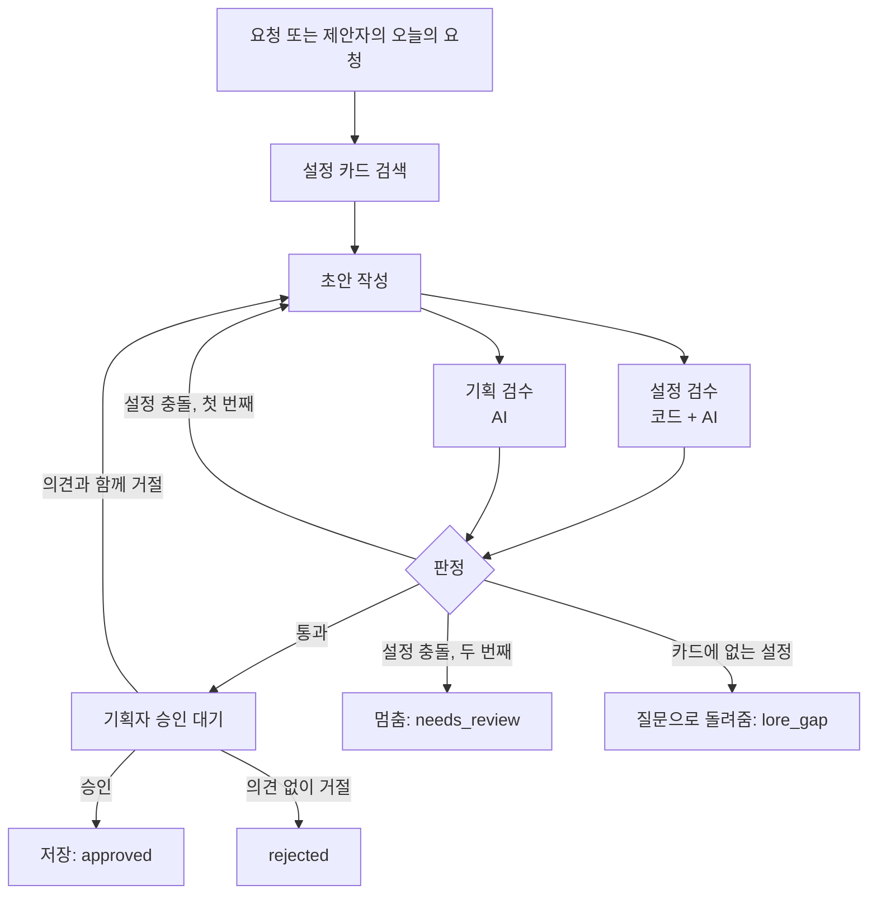

# 퀘스트 작업실 (Quest Workshop)

[](https://github.com/thegamerham-ship-it/quest-workshop/actions/workflows/tests.yml)

**설정 카드를 근거로 게임 서브 퀘스트를 쓰고, 두 AI 검수자가 서로 모른 채 따로 검수한 뒤, 기획자가 승인하는 멀티 에이전트 도구.**

게임 시나리오·퀘스트 기획 7년 차 기획자가 "AI가 쓴 퀘스트를 그대로 믿을 수 없는 이유"를 구조로 풀어 본 프로젝트다.
LangGraph · Gemini · Streamlit · pytest.

- 웹 데모: https://cheonjiin-quest.streamlit.app/ → **둘러보기 시작**을 누르면 암호 없이 들어간다.
  - 둘러보기: 가짜 모델로 제안 → 작성 → 두 검수 → 승인 흐름을 직접 눌러 볼 수 있다. "승인된 퀘스트" 탭에서는 승인한 퀘스트로 반복 퀘스트 변형(의뢰인·대사만 바꾼 버전)을 만들어 원본과 나란히 볼 수 있다.
  - 실제 Gemini 호출은 API 비용 때문에 암호가 걸려 있다.

## 왜 만들었나

AI에게 퀘스트를 쓰게 하면 세 가지가 문제였다.

1. **설정을 지어낸다.** 마을에 없는 바다, 아직 나오면 안 되는 2장 동료를 태연하게 넣는다.
2. **스스로 검수하면 자기 글에 관대하다.** 쓴 AI가 검수까지 하면 같은 착각을 반복한다.
3. **고친 사실을 숨긴다.** 요청이 설정과 부딪히면 알아서 바꿔 쓰는데, 기획자는 바뀐 줄 모른다.

그래서 역할을 나눴다.

| 역할 | 누가 | 하는 일 |
|---|---|---|
| 설정 카드 | 사람(기획자) | 세계의 사실. 카드에 없는 것은 AI가 지어내지 않고 "설정에 없음"으로 되묻는다 |
| 제안자 | AI | 카드와 이미 만든 퀘스트를 보고 겹치지 않는 오늘의 요청 N개 제안. 소재가 모자라면 억지로 채우지 않고 "이런 카드가 더 필요하다"고 보고 |
| 작성자 | AI | 카드 번호를 근거로 달아 퀘스트 초안(목표·단계·대사·보상 가안) 작성 |
| 설정 검수자 | 코드 + AI | 사실 검사. 없는 근거 번호, 뒷장 요소, "있으면 안 되는 것"은 코드가 확실히 막고, 뜻이 어긋나는 것은 AI가 본다 |
| 기획 검수자 | AI | 가치 판단. 목표가 분명한지, 동기가 납득되는지, 말투가 맞는지 |
| 판정 | 코드 | 설정 충돌이면 1회만 다시 쓰게 하고, 그래도 안 되면 멈춰서 사람에게 넘긴다 |
| 승인 | 사람(기획자) | 승인 / 의견 주고 고쳐 쓰기 / 거절. 준 의견은 지침으로 쌓여 이후 모든 퀘스트에 반영 |

**사실(설정)은 기계가 막고, 가치(재미·말투)는 사람이 정한다.** 설정 충돌은 재작성을 강제하지만, 기획 검수 의견은 강제하지 않고 승인 화면에 보여 준다.

## 흐름



- 두 검수자는 LangGraph `Send`로 **동시에, 서로의 결과를 보지 않고** 돈다. 한쪽 의견에 끌려가지 않게 하려는 것이다.
- 재작성은 **1회까지**. 무한히 고치게 두면 비용이 늘고, 두 번 연속 충돌이면 요청 자체가 설정과 맞지 않는 경우가 많았다.
- 기획자 승인은 LangGraph `interrupt()`로 멈춰 기다린다.

## 결과

### 테스트 요청 5개 (Gemini)

| 요청 | 기대 | 1차 | 고친 뒤 |
|---|---|---|---|
| 이장이 뒷산의 이상한 빛을 조사해 달라는 퀘스트 | 바로 통과 → 승인 | ✗ 보상을 되물음 | ✓ approved |
| 이장이 **바닷가**에서 떠내려온 갑옷을 찾아 달라는 퀘스트 (마을에 바다가 없음) | 설정에 맞게 바꿔 쓰고, 바꾼 점을 기획자에게 알림 | ✗ 재작성에도 바닷가 유지 | ✓ approved, "요청에서 바꾼 점" 표시 |
| 도사가 **기계 동료**와 기사를 구하는 퀘스트 (기계는 2장) | 두 번 충돌 → 사람 검토 | ✗ 기계를 몰래 빼고 씀 | ✓ needs_review |
| 1번을 "이장 말투를 더 겁먹은 듯이"로 거절 | 의견 반영 재작성 → 승인 | ✗ 보상을 되물음 | ✓ approved |
| 뒷산 바위 제단의 **유래**를 알아보는 퀘스트 (카드에 없음) | 지어내지 않고 질문 | ✓ lore_gap | ✓ lore_gap |

1차 뒤 고친 것: 작성자는 뼈대가 비었을 때만 질문하고 보상은 가안으로 채운다. 요청과 카드가 부딪히면 카드가 우선이다. 요청 문장 자체의 뒷장 요소도 코드가 검사해 "요청에서 바꾼 점"으로 보여 준다.

### 제안 에이전트: 하루 5개가 겹치지 않고 나오나

| 실행 | 설정 카드 | 결과 |
|---|---|---|
| 1일차 | 14장 | 4개만 새로움. "새 소재 부족"을 보고하고 필요한 카드(장터 상인·주모·포졸·담비굴 등)를 제안 |
| 2일차 1차 | 20장 | 여전히 부족. "생활형 주민, 하급 포졸, 관아 심부름거리가 없다"고 보고 |
| 2일차 2차 | 33장 + 제안 규칙 수정 | **5개 모두 새로움, 의뢰인 5명·하는 일 5가지 모두 다름** |

두 가지를 배웠다.

- **AI가 모자람을 보고하고 사람이 채우는 협업이 됐다.** 보고대로 카드를 쓰자 실제로 그 카드(보부상, 포졸, 빨래터, 산짐승, 담비굴)에서 퀘스트가 나왔다.
- **카드를 늘리는 것보다 규칙 한 줄이 더 컸다.** 처음엔 "의뢰인·장소·목적 중 하나만 같아도 겹침"이어서 카드 한 장에서 퀘스트가 하나만 나왔다. "셋이 모두 같을 때만 겹침"으로 고쳤다. 게임에서 한 NPC가 퀘스트를 여러 개 주는 건 당연한데, AI에게는 그걸 말해 줘야 했다.

## 돌려 보기

```bash
python -m venv .venv
source .venv/bin/activate          # Windows: .venv\Scripts\activate
pip install -r requirements.txt

python -m quest_workshop.run --demo --llm fake   # API 키 없이 테스트 요청 5개 자동 실행
python -m pytest -q                               # 테스트 59개
streamlit run streamlit_app.py                    # 웹 화면
```

실제 Gemini로 돌리려면 `.env.example`을 `.env`로 복사하고 `GOOGLE_API_KEY`를 넣는다.

```bash
python -m quest_workshop.run "이장이 도사에게 뒷산의 이상한 빛을 조사해 달라고 맡기는 퀘스트"
python -m quest_workshop.run --propose 5     # 오늘의 요청 5개 → 각각 작성·검수 → 하나씩 승인
python -m quest_workshop.compare --llm gemini   # A/B/C 비교: 작성자만 / 설정 검수 / 두 검수자. 결과는 output/compare/
python -m quest_workshop.variants output/quests/quest_xxx.json --llm gemini   # 반복 퀘스트 변형 3개. 결과는 output/variants/
```

가짜 모델(`--llm fake`)은 흐름 확인용이다. 정해진 답을 돌려주고, 설정 검수는 코드 검사만 한다. 뜻까지 보는 검수는 Gemini 모드에서 한다.

## 설정 카드

`data/lore_ch1.json`, 1장 카드 33장. 오리지널 세계관 "천지인"(중세 기사 · 한국 도사 · SF 기계가 한 세계)의 첫 작품, 떠돌이 도사의 1장 마을 "솔뫼"가 무대다.

```json
{
  "card_id": "place_village_01",
  "type": "장소",
  "title": "솔뫼 마을",
  "chapters": [
    1
  ],
  "keywords": [
    "솔뫼",
    "마을",
    "장터",
    "고갯마루"
  ],
  "text": "산으로 둘러싸인 작은 산골 마을. 바다는 보이지 않는다. 장터가 있고, 마을 뒤편으로 뒷산에 오르는 길이 하나 있다. 마을 어귀 고갯마루에 서낭당이 있다.",
  "not_present": [
    "바닷가",
    "바다",
    "해변",
    "항구",
    "갯벌"
  ],
  "spoiler": ""
}
```

- `chapters`: 등장할 수 있는 장. 1장 퀘스트를 쓸 때 다른 장 카드는 검색에서 처음부터 뺀다.
- `not_present`: 이 세계에 없는 것. 초안과 요청 문장에 나오면 코드가 막는다.
- `spoiler`: 작성자는 못 보고 검수자만 본다. 비밀을 미리 흘리는지 검사하는 데 쓴다.
- `data/main_story_ch1.json`: 메인 사건 목록. 서브 퀘스트가 메인 사건을 건드리면 막는다.

## 파일

| 경로 | 하는 일 |
|---|---|
| `quest_workshop/graph.py` | LangGraph 흐름, `Send`로 두 검수자 동시 실행, 판정 규칙, `interrupt()` 승인 |
| `quest_workshop/llm.py` | 제안자·작성자·설정 검수자·기획 검수자 프롬프트. 가짜 모델과 Gemini |
| `quest_workshop/checks.py` | 코드 검사: 없는 근거 번호, 뒷장 요소, 있으면 안 되는 것, 근거 없는 단계 |
| `quest_workshop/lore.py` | 카드 불러오기와 검색 |
| `quest_workshop/propose.py` | 제안 에이전트. 요청 N개 → `Send`로 동시에 작성·검수 → 승인 대기 목록 |
| `quest_workshop/guide.py` | 기획자 지침: 거절·고쳐 쓰기 때 준 의견을 쌓아 이후 제안·작성·검수에 반영 |
| `quest_workshop/sync.py` | 웹 서버가 재시작해도 승인 퀘스트가 남도록 GitHub `quest-data` 브랜치에 저장 |
| `quest_workshop/compare.py` | A/B/C 비교: 같은 요청을 작성자만 / 설정 검수+재작성 / 두 검수자+판정으로 돌려 결과·호출 수를 표로 |
| `quest_workshop/variants.py` | 반복 퀘스트 변형: 단계·보상·열림 조건은 그대로, 의뢰인·대사만 새로. 설정 검수·골격 유지·대사 겹침 점검 |
| `quest_workshop/run.py` | 터미널 실행과 데모 |
| `streamlit_app.py` | 웹 화면: 오늘의 제안 / 요청 직접 넣기 / 승인된 퀘스트(반복 퀘스트 변형 만들기) |
| `tests/` | pytest 59개. 가짜 모델로 모든 경로(approved, rejected, needs_review, lore_gap)를 확인 |

## AI와 함께 만든 방식

코드는 AI(Claude)와 함께 짰다. 나눈 일은 이렇다.

- **기획자(나)**: 세계관과 설정 카드 33장 확정, 검수 기준과 판정 규칙(무엇이 사실이고 무엇이 가치인가), 기대 결과 정의, 실제 결과가 맞는지 판정, 금지 클리셰 지정.
- **AI**: 코드 작성, 테스트 작성, 카드 초안 제안(기획자가 확정한 것만 반영).
- 순서: 가짜 응답으로 흐름을 먼저 돌리고 → 테스트를 붙이고 → 실제 Gemini를 연결해 → 기대와 다른 결과를 고친다.
